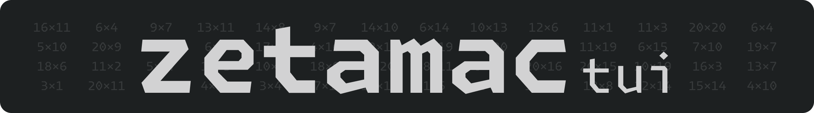
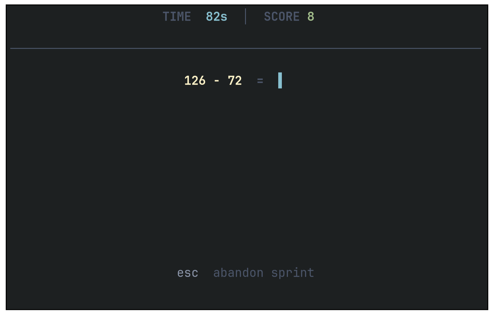

[Zetamac](https://arithmetic.zetamac.com/) arithmetic speed drills for the terminal. 

### Motivation

The original web implementation does not store any results, and thus doesn't allow to track progress. Furthermore, it requires an internet connection.

### Details

The current implementation of zetamac-tui uses the default Zetamac settings (2 minute timer). Successful runs are stored in the `zetamac_history.csv`, producing the columns: 

- `timestamp` 
- `attempt` 
- `score` 
- `duration_seconds` 
- `equations_per_second` 

